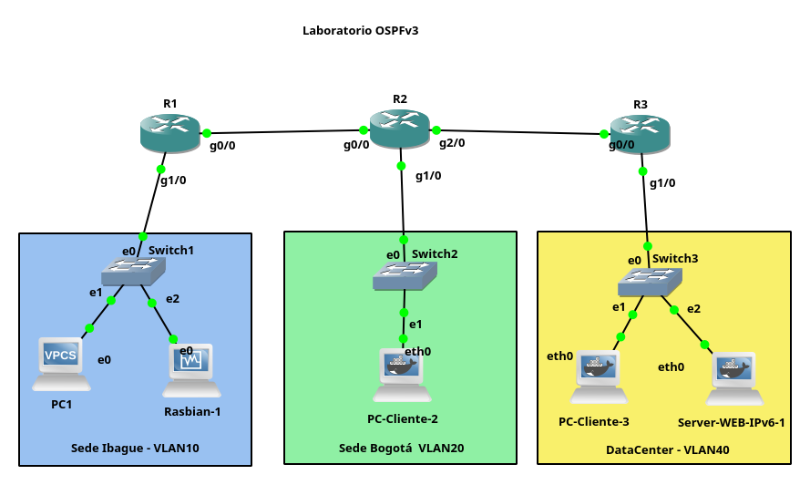

# IRYCIP · Laboratorio IPv6 con OSPFv3, DHCPv6 y servidor OVA en GNS3

Laboratorio docente reproducible para el curso **Internet: Redes y Comunicaciones IP (IRYCIP)**. Integra tres routers Cisco c7200, GNS3, clientes Linux Docker y un servidor Nginx con el OVA **«IPv6 bajo investigación» (18 escenas)**. Raspbian en VirtualBox es un **complemento gráfico opcional**, no un requisito para completar la práctica.



## Modalidades según el equipo

- **Ligera (recomendada para equipos personales):** GNS3 + routers Cisco compatibles + VPCS + Docker Linux y Nginx. Las pruebas web se realizan con `curl` desde un cliente de GNS3; las capturas PCAP pueden examinarse sin ejecutar Raspbian.
- **Completa (aulas o equipos de mayores recursos):** añade **Raspbian-1** con entorno gráfico, virtualizado en VirtualBox e integrado con GNS3. Permite usar Chromium y Wireshark en vivo.
- **Solo material didáctico:** OVA HTML/SCORM y archivo PCAP, sin simulación; útil para revisar las evidencias desde equipos modestos.

**No se incluye cliente GUI Docker ni noVNC**, porque no forman parte del escenario final validado.

## Plan de direccionamiento

| Segmento | Red IPv6 | Gateway / dispositivos |
| --- | --- | --- |
| Sede Ibagué, LAN10 | `2001:DB8:ACAD:10::/64` | R1 `2001:DB8:ACAD:10::1` |
| Sede Bogotá, LAN20 | `2001:DB8:ACAD:20::/64` | R2 `2001:DB8:ACAD:20::1` |
| DataCenter, LAN40 | `2001:DB8:ACAD:40::/64` | R3 `2001:DB8:ACAD:40::1`; Nginx `2001:DB8:ACAD:40::10` |
| R1 ↔ R2 | `2001:DB8:ACAD:100::/64` | R1 `::1`, R2 `::2` |
| R2 ↔ R3 | `2001:DB8:ACAD:200::/64` | R2 `::1`, R3 `::2` |

Los prefijos `2001:DB8::/32` están reservados para documentación; **no se usan para salida real a Internet**. La topología muestra tres LAN sobre switches Ethernet de GNS3. Sus etiquetas VLAN10/20/40 son identificadores didácticos: no implican necesariamente configuración 802.1Q.

## Contenido incluido

| Ruta | Contenido |
| --- | --- |
| `docker/cliente-linux/` | Dockerfile del cliente ligero `org-ipv6-cliente:1` |
| `docker/servidor-ova-web/` | Nginx, Bash, diagnóstico IPv6 y script de IP automática |
| `gns3/ios/` | Configuraciones Cisco **de referencia**, adaptables a las interfaces del router |
| `ova/html/` | Fuente HTML **v5 de 18 escenas**, imágenes y PCAP enlazado |
| `ova/scorm/` | Paquete SCORM 1.2 **generado desde v5** para importar en Moodle |
| `ova/evidencias/` | Archivo PCAP de tráfico HTTP sobre IPv6 |
| `docs/` | Montaje, Raspbian, Moodle, validaciones y topología |
| `scripts/` | Construcción Docker, validación de recursos y empaquetado SCORM |

## Inicio rápido

```bash
git clone https://github.com/danfelun/IRYCIP-GNS3_IPv6_OSPF.git
cd IRYCIP-GNS3_IPv6_OSPF
./scripts/check_ova.sh
./scripts/build_images.sh
```

En **GNS3 local** configure tres Cisco c7200 con IOS disponible legalmente, tres switches Ethernet, VPCS, dos instancias `org-ipv6-cliente:1` y un servidor `org-ipv6-ova-web:3` en LAN40. La construcción solo crea imágenes; **no crea automáticamente el proyecto GNS3**. Siga la [guía de despliegue](docs/GUIA_DESPLIEGUE_GNS3.md).

El servidor web anuncia su contenido en `http://[2001:db8:acad:40::10]/`. Los **corchetes son obligatorios** cuando se usa un literal IPv6 en una URL HTTP. La asignación automática de `::10` depende de que GNS3 permita `NET_ADMIN` a ese contenedor; se debe **confirmar con los logs y un reinicio de nodo**, no asumir persistencia solo por construir la imagen.

## Recursos Moodle

El paquete listo para **importación y prueba SCORM 1.2** está en `ova/scorm/ORIGEN_IPV6_SCORM12_18_ESCENAS.zip`. El **H5P anterior era beta y no se ofrece como equivalente validado** de estas 18 escenas; consulte [Moodle](docs/GUIA_MOODLE.md). El puntaje SCORM debe ensayarse en el Moodle de destino.

## Requisitos y limitaciones

GNS3 instalado localmente, Docker Engine, Wireshark (para captura), un IOS Cisco c7200 provisto legalmente, acceso de usuario al socket Docker y VirtualBox **solo si se usa Raspbian**. El repositorio no redistribuye imágenes IOS Cisco, archivos VDI de terceros, ni un proyecto `.gns3project` final exportado. Las configuraciones IOS son referencias que deben validarse en la instalación de cada estudiante.

El servidor LAN40 usa IPv6 estática `::10`, y LAN40 también dispone de DHCPv6. **Reserve/controle esa dirección para evitar colisiones con concesiones DHCPv6**. Se recomienda probar primero en una red de laboratorio aislada.

## Guías

- [Despliegue y topología](docs/GUIA_DESPLIEGUE_GNS3.md)
- [Cliente gráfico Raspbian opcional](docs/GUIA_RASPBIAN.md)
- [Moodle, SCORM y H5P](docs/GUIA_MOODLE.md)
- [Pruebas y diagnóstico](docs/VALIDACION.md)
- [Origen de componentes y licencia](docs/AVISOS.md)
